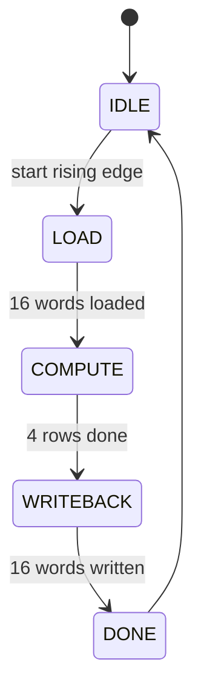

# Near-Memory Processing Unit (NMPU) for Matrix Multiplication

A synthesizable Verilog implementation of a **4×4 signed 8-bit matrix multiplier** that keeps its operands in registers right next to the SRAM banks and computes **one full row of the result per clock cycle** using a broadcast array of 16 multipliers and four adder trees.

`C = A × B`, with A and B as 8-bit signed matrices and C as a 24-bit signed matrix. A multiply completes **38 clock cycles after `start`** (380 ns at 100 MHz) and is verified bit-accurately in simulation.

---

## Highlights

- **Near-memory compute:** operands are copied once from the SRAM banks into local register files and reused for the whole multiply, so the SRAM is never re-read during compute.
- **Row-per-cycle compute:** 16 multipliers and 4 adder trees produce 4 results (one row of C) every cycle.
- **Simple host interface:** one flat address space with three banks (A, B, C), 1-cycle synchronous reads, and `start` / `done` / `busy` handshaking.
- **Drop-in SRAM banks:** three single-port synchronous SRAMs (`sram_bank`); the memory macro can be swapped without touching the datapath.
- **Self-checking testbench:** 5 directed tests (sequential, signed, identity, extreme values, reset-and-restart), 80 element checks.

---

## Results

All numbers below were measured with Icarus Verilog (simulation) and Yosys 0.33 generic-gate synthesis (area proxy only, not a sign-off flow).

| Metric | Value |
|---|---|
| Latency (`start` → `done`) | **38 cycles** (380 ns @ 100 MHz) |
| Multipliers | 16 (8×8 signed) |
| Output rate during compute | 4 elements / cycle |
| Testbench result | **80 / 80 checks passed**, 5 tests |
| Area (Yosys, generic gates) | ~12.6k cells, ~1.2k flip-flops |

### Comparison with the other designs in this project

| Design | Multipliers | Cycles (4×4) | Cells (Yosys) | Flops |
|---|---|---|---|---|
| Serial NMPU (1 MAC PE, FSM-driven) | 1 | 178 | 3,112 | 733 |
| **This design (broadcast MAC array)** | 16 | **38** | 12,633 | 1,246 |
| Systolic array (16 PEs) | 16 | 45 | 19,226 | 1,640 |

This design is 4.7× faster than the serial NMPU and 1.2× faster than the systolic array, at about two thirds of the systolic array's area.

---

## Architecture

```
                 host interface
        (we, bank_sel, addr, wdata / rdata)
                       │
        ┌──────────────┼──────────────┐
        ▼              ▼              ▼
   ┌─────────┐    ┌─────────┐    ┌──────────┐
   │ SRAM A  │    │ SRAM B  │    │  SRAM C  │
   │ 16 × 8  │    │ 16 × 8  │    │  16 × 24 │
   └────┬────┘    └────┬────┘    └─────▲────┘
        │ LOAD         │ LOAD          │ WRITEBACK
        ▼              ▼               │
   ┌─────────┐    ┌─────────┐    ┌─────┴────┐
   │ nm_a_reg│    │ nm_b_reg│    │ nm_c_acc │
   │ 16 × 8  │    │ 16 × 8  │    │  16 × 24 │
   └────┬────┘    └────┬────┘    └─────▲────┘
        │ row_sel      │ all           │ COMPUTE
        │ selects      │ columns       │ (1 row / cycle)
        ▼              ▼               │
     ┌────────────────────────────┐    │
     │  4 columns × 4 multipliers │    │
     │  (16 total) + 4 adder trees├────┘
     └────────────────────────────┘
                       ▲
                       │  FSM: IDLE → LOAD → COMPUTE → WRITEBACK → DONE
```

### Datapath

- **Local operand registers:** `nm_a_reg` and `nm_b_reg` hold all of A and B after the load phase. `nm_c_acc` holds the result before write-back.
- **Broadcast MAC array:** in each compute cycle, `row_sel` selects one row of A. For every output column `c` and every `k`, the array computes `A[row][k] × B[k][c]`. A balanced adder tree sums the four products of each column, giving `C[row][0..3]`.
- **Exact arithmetic:** products are sign-extended to the accumulator width before summing, so there is no intermediate truncation.

### Controller

| State | Cycles | What happens |
|---|---|---|
| `IDLE` | 1 | Waits for a rising edge on `start`; sets `busy`. |
| `LOAD` | 17 | Reads A and B at one address per cycle into the local registers (16 words plus 1 cycle for the SRAM read latency). |
| `COMPUTE` | 4 | One row of C per cycle is written into `nm_c_acc`. |
| `WRITEBACK` | 16 | Copies C to SRAM bank C, one word per cycle (single write port). `done` is asserted with the last write. |
| `DONE` | 1 | Clears `done` and returns to `IDLE`. |

`1 + 17 + 4 + 16 = 38` cycles from `start` to `done`.



---

## Interface

### Ports

| Port | Dir | Width | Description |
|---|---|---|---|
| `clk` | in | 1 | Clock |
| `rst_n` | in | 1 | Active-low asynchronous reset |
| `start` | in | 1 | Rising edge starts a multiply (a 1-cycle pulse or a held level both work) |
| `done` | out | 1 | 1-cycle pulse; when high, all of C has been written to SRAM bank C |
| `busy` | out | 1 | High while a multiply is running |
| `host_we` | in | 1 | Host write enable |
| `host_bank_sel` | in | 2 | `00` = A, `01` = B, `10` = C |
| `host_addr` | in | `ADDR_WIDTH` | Word address, `row * 4 + col` |
| `host_wdata` | in | `ACC_WIDTH` | Write data (signed). A and B use the low 8 bits |
| `host_rdata` | out | `ACC_WIDTH` | Read data (signed, sign-extended), valid 1 clock after the address |

### Memory map

| Bank | `host_bank_sel` | Depth × width | Element at `host_addr` |
|---|---|---|---|
| A | `2'b00` | 16 × 8 | `A[addr / 4][addr % 4]` |
| B | `2'b01` | 16 × 8 | `B[addr / 4][addr % 4]` |
| C | `2'b10` | 16 × 24 | `C[addr / 4][addr % 4]` |

### Parameters

| Parameter | Default | Notes |
|---|---|---|
| `N` | 4 | Matrix dimension. **Only N = 4 is supported** (see Limitations) |
| `DATA_WIDTH` | 8 | Width of A and B elements |
| `ACC_WIDTH` | 24 | Width of C elements and of the host data bus |
| `DEPTH` | `N*N` | Words per bank |
| `ADDR_WIDTH` | 4 | Address width |

### Host usage sequence

1. Reset the design (`rst_n` low, then high).
2. Write A: for `i = 0..15` set `host_we=1`, `host_bank_sel=00`, `host_addr=i`, `host_wdata=A[i]`, one word per clock.
3. Write B the same way with `host_bank_sel=01`.
4. Deassert `host_we`, then raise `start` (rising edge).
5. Wait for `done`.
6. Read C: set `host_bank_sel=10` and `host_addr=i`, wait one clock, then sample `host_rdata`.

Do not access the SRAM banks from the host while `busy` is high. Host writes are blocked during a multiply and host reads would see the controller's addresses.

---

## Repository files

| File | Description |
|---|---|
| `nmpu_top.v` | Top level: SRAM arbitration, near-memory registers, MAC array, controller |
| `sram_bank.v` | Single-port synchronous SRAM, 1-cycle read latency, read-first |
| `tb_nmpu_top.v` | Self-checking testbench |

---

## Simulation

### Icarus Verilog

```bash
iverilog -g2005-sv -o nmpu.vvp sram_bank.v nmpu_top.v tb_nmpu_top.v
vvp nmpu.vvp
```

The testbench tries to read optional `*.hex` golden vectors with `$readmemh` and falls back to built-in vectors if they are missing, so any "cannot open file" warning from a simulator is harmless. A waveform is written to `nmpu_sim.vcd`:

```bash
gtkwave nmpu_sim.vcd
```

### Vivado (xsim)

Add `sram_bank.v` and `nmpu_top.v` as design sources and `tb_nmpu_top.v` as the simulation source, set `tb_nmpu_top` as top, and run the behavioral simulation.

### Expected output

```
[INFO]  Test 1 (Sequential 1..16 x 1..16): completed in 38 cycles (380 ns @ 100 MHz; Systolic baseline: 45)
[INFO]  Test 2 (Signed & Zero - Golden Model): completed in 38 cycles ...
[INFO]  Test 3 (Identity x Signed): completed in 38 cycles ...
[INFO]  Test 4 (Extreme Signed -128/127/0): completed in 38 cycles ...
[INFO]  Test 5 (Reset then restart - Zero x Identity): completed in 38 cycles ...
NMPU TOP SUMMARY: 80 PASSED, 0 FAILED
*** ALL 80 ELEMENT CHECKS PASSED (100% BIT-ACCURATE) ***
```

---

## Verification

| Test | Purpose |
|---|---|
| 1. Sequential `1..16 × 1..16` | Hand-checkable positive values (`C[0][0] = 90 … C[3][3] = 600`) |
| 2. Signed matrices | Mixed positive and negative values; the testbench computes the golden `C = A × B` itself |
| 3. Identity × signed `B` | `I × B = B`, checks data routing and row selection |
| 4. Extreme values (−128, 0, 127) | Worst-case sign handling and magnitude |
| 5. Reset, then zero × identity | Reset mid-session followed by a clean restart |

Each test loads A and B through the host port, pulses `start`, checks that `done` rises with `busy` low, measures the latency, and reads all 16 elements of C back through the host port.

---

## Limitations

- **N = 4 only.** The `N` parameter exists, but the adder tree is hardwired to four products, `row_sel` is 2 bits, and `ADDR_WIDTH` is not derived from `N`.
- **Latency is dominated by data movement.** `LOAD` and `WRITEBACK` take 33 of the 38 cycles; compute itself takes 4. The 16 multipliers are idle most of the time because the SRAM banks have a single port.
- **Duplicated storage.** A, B and C are held both in the SRAM banks and in the local register files.
- **Oversized accumulators.** The result is stored in 24 bits, but for 8-bit signed inputs and N = 4 the largest magnitude is 65,536, which needs only 18 bits.
- **Reset on every storage word.** `sram_bank` and the local registers clear every word on reset, so they synthesize to reset flip-flops rather than a RAM macro.
- **No host access while busy.** There is no arbitration or stall; the host must wait for `done`.
- **Area figures are indicative.** Yosys generic cell counts are a proxy; timing and power need a real library-based flow.

---

## Roadmap

- Bank A and B so a whole row and column are fetched in one cycle, removing most of the load time.
- Compute one dot product per cycle with 4 multipliers instead of 16 multipliers across the array.
- Narrow the result datapath to 18 bits and remove the reset from storage arrays.
- Make the datapath truly parametric in `N`.
- Run a full synthesis and place-and-route flow for real timing, area and power numbers.

---

## License

Add your license here (for example MIT).

## Contributors

Add contributor names here.
